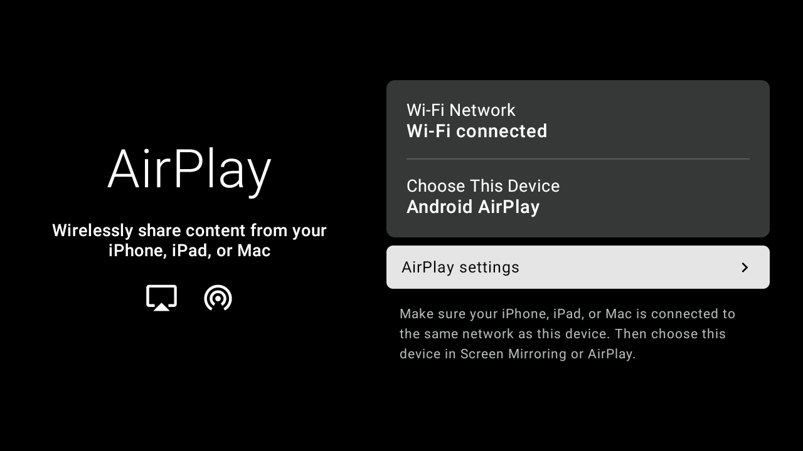
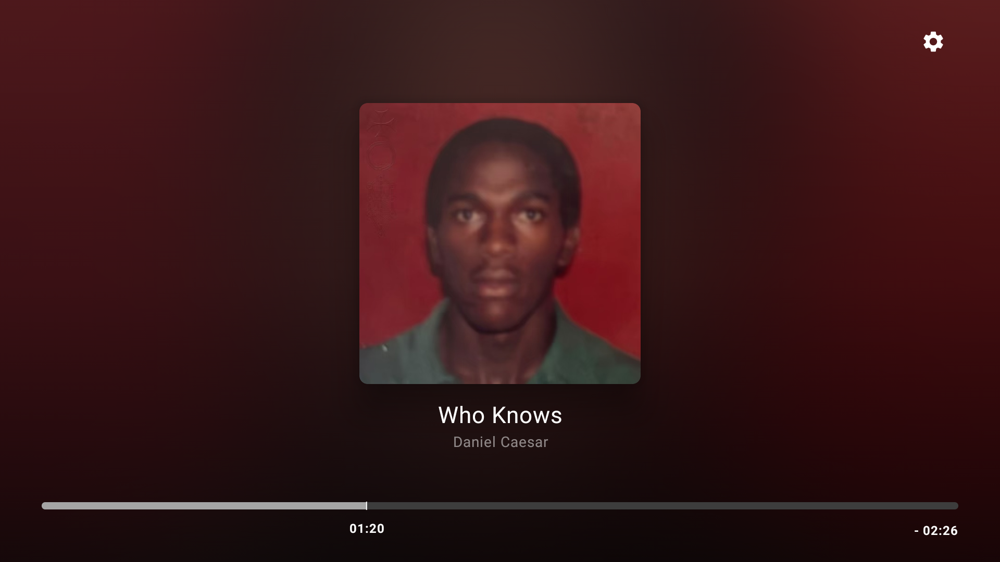
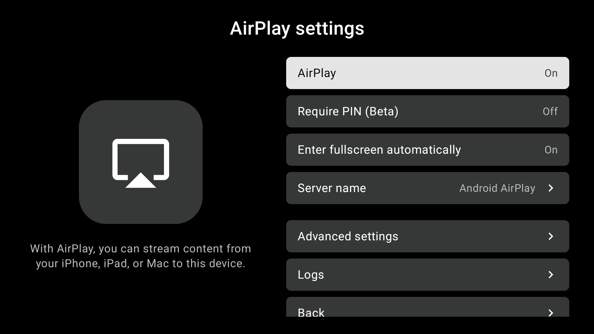
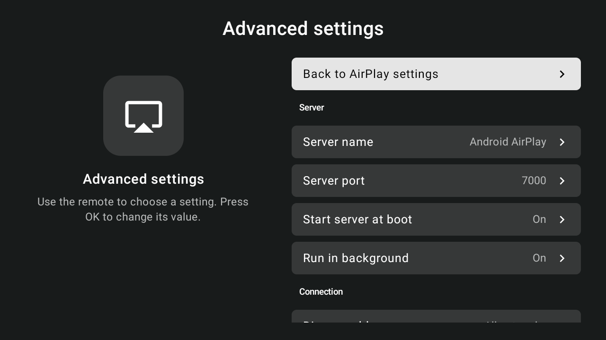

# AirPlay TV Receiver

An AirPlay receiver for Android with a TV-focused interface, remote navigation, and an album-art music player.

This project is a fork of **[android-airplay-server](https://github.com/jqssun/android-airplay-server)** by **[jqssun](https://github.com/jqssun)** and its contributors. The original project provides the Android receiver and playback foundation; this fork focuses on the Android TV experience. AirPlay/RAOP support is powered by [UxPlay](https://github.com/FDH2/UxPlay).

## Screenshots

Captured from the app running on a Mi TV. The receiver name and network information depend on your device; album artwork and track details come from the audio sender.

| Home | Now Playing |
| --- | --- |
|  |  |

| AirPlay settings | Advanced settings |
| --- | --- |
|  |  |

## What this fork changes

- Pure-black AirPlay home screen with network information, receiver name, and a settings shortcut.
- TV settings with a fixed left panel and independently scrolling options on the right.
- Remote-friendly advanced settings, value-selection dialogs, and text editing.
- Now Playing screen with centered album art, track information, and a stable blurred-artwork background.
- Smooth artwork and blurred-background crossfades when the cover changes, with a separate pause/shrink animation.
- Full-screen AirPlay passcode tiles that bring the app forward when a sender requests a PIN.
- Audio playback controlled directly by the remote: OK for play/pause, Left/Right for previous/next track.
- A display-only audio timeline showing elapsed and remaining time. Audio scrubbing is disabled.
- Pause-state synchronization that freezes the timer and prevents late metadata from restarting the paused UI.
- Logs accessible from AirPlay settings.
- Overlay-permission navigation that supports Android TV's general permission list.

## Receiver features

The fork retains the upstream receiver capabilities:

- Screen mirroring with H.264 and H.265/HEVC decoding.
- Audio streaming with ALAC, AAC-LC, and AAC-ELD decoding.
- Video playback with HLS, downloads, and playback controls.
- Picture-in-Picture and automatic fullscreen options.
- Optional PIN authentication.
- Resolution, overscan, frame-rate, and audio-latency settings.
- Software audio-decoder fallback and a diagnostic overlay.
- Android media-session and notification controls.
- Wired connections through supported USB-tethering configurations.

## Compatibility and limitations

- The declared minimum is **Android 6.0 / API 23**.
- The redesigned interface has been tested on a Mi TV with a directional-pad remote.
- Phone and tablet support remains enabled, with stacked layouts on narrow screens and touch controls. The redesigned phone experience has not yet been verified.
- Connect the receiver and sender to the same local network. Network isolation can prevent discovery.
- To display the Wi-Fi name, select **Show network name** on the home screen, allow precise location access, and enable Android's Location setting. Android treats SSIDs as location-sensitive information. If access is denied, the app shows a connection label and AirPlay still works.
- DRM-protected content, including protected Apple TV content, is not supported.
- Direct AirPlay from the macOS Music app can fail with “not compatible with this version of Music.” A tested Mac sent a FairPlay v2 handshake; the bundled UxPlay implementation accepts v3 only. Selecting the receiver through macOS Sound / Control Center can still stream system audio, but artwork and track details may be unavailable. Enabling ALAC alone does not resolve this handshake mismatch.
- The audio timeline displays progress only. Video playback has its own controls.

## Getting started

1. Download the APK from this fork's [releases](https://github.com/Jheenz/airplay-tv-receiver/releases), or build one using the instructions below. The first preview release is debug-signed.
2. Connect your Android device and your iPhone, iPad, or Mac to the same network.
3. Open the app and enable AirPlay in **AirPlay settings**.
4. Select the displayed receiver name from **Screen Mirroring** or your audio app's **AirPlay** output picker.

Use the remote's directional buttons to navigate and OK to activate a control. Back closes a dialog or returns to the previous screen.

During video playback on TV, OK toggles play/pause and Left/Right seek backward/forward by 10 seconds. Up focuses the playback action buttons; Down returns to playback. The small pause symbol beside the elapsed time is a status indicator and cannot receive focus.

On the audio Now Playing screen, OK toggles play/pause and Left/Right select the previous/next track. Up focuses Settings; Down returns to playback. The timeline uses the same moving elapsed timestamp and pause indicator as video, with seeking disabled and no skip indicators or transport buttons.

The audio timeline hides after five seconds of playback. Pausing keeps it visible; Down reveals it again and restarts the five-second timer while playing.

The elapsed timestamp follows the playhead, with its seconds colon centered beneath the marker. The remaining-time label hides as the elapsed timestamp approaches it near the end, and returns when there is enough space.

Each TV remote skip shows a 10-second circular-arrow indicator for one second: rewind to the left of the elapsed time, forward to its right. Forward temporarily replaces the pause indicator when paused; repeated skips restart the one-second timer.

The TV video overlay displays the title and author/artist when provided by stream metadata or the sender's audio metadata. Missing fields stay hidden; some senders provide only the video stream without these details.

To enable **Open this application on connect** on Android versions that require overlay access, allow **AirPlay Server** in **Display over other apps**. Some TVs show a list of apps instead of opening an individual permission page.

## Building

Requirements:

- JDK 17 or newer; the included CI configuration uses JDK 21.
- Android SDK 37, NDK `27.0.12077973`, and CMake `3.22.1`.
- Git with submodule support, Python 3, Perl, and Make for the native dependencies.
- Network access for the first Gradle and native-dependency downloads.

From your fork's checkout:

```bash
git submodule update --init --recursive
./gradlew :app:assembleDebug
```

The debug APK is generated at:

```text
app/build/outputs/apk/debug/app-debug.apk
```

Install it on a connected device:

```bash
adb install -r app/build/outputs/apk/debug/app-debug.apk
```

The native build downloads OpenSSL 3.4.4 through `openssl-cmake`. If its configured mirror returns an HTML page instead of an archive, replace that download URL in `app/src/main/cpp/third_party/openssl-cmake/cmake/BuildOpenSSL.cmake` with the [official OpenSSL 3.4.4 source archive](https://github.com/openssl/openssl/releases/download/openssl-3.4.4/openssl-3.4.4.tar.gz), then retry the build.

The [included signed-release workflow](.github/workflows/apk.yml) runs manually and needs your own signing configuration and repository secrets before use. Preview tags do not trigger it.

## Fork identity

The repository is documented as **AirPlay TV Receiver**. The installed app currently retains the upstream label **AirPlay Server** and application ID `io.github.jqssun.airplay`. Update the app identity and signing configuration when preparing a separately branded release.

Upstream store listings and upstream releases belong to the original project; they do not distribute this fork's UI changes.

## Configure through ADB

Settings can also be configured from an ADB shell. The settings receiver requires `android.permission.DUMP`, so ordinary installed apps cannot change these values.

For example, change the advertised receiver name:

```bash
adb shell 'am broadcast \
  -n io.github.jqssun.airplay/.SettingsReceiver \
  -a io.github.jqssun.airplay.SET_SETTING \
  --es key server_name \
  --es value "Living Room TV"'
```

List current settings as JSON:

```bash
adb shell am broadcast \
  -n io.github.jqssun.airplay/.SettingsReceiver \
  -a io.github.jqssun.airplay.LIST_SETTINGS
```

## Implementation

The app uses UxPlay for the native AirPlay/RAOP implementation, a JNI bridge to Kotlin, Jetpack Compose for the interface, MediaCodec for hardware decoding, Oboe for audio output, and Media3/ExoPlayer for video playback. CMake builds the native components in [`app/src/main/cpp`](app/src/main/cpp).

For USB tethering, Apple devices support CDC-NCM. Android devices that default to RNDIS may require this setting:

```bash
adb shell settings put global tether_force_usb_functions 1
```

## Credits

- **[jqssun](https://github.com/jqssun) and contributors** — creators of the original [android-airplay-server](https://github.com/jqssun/android-airplay-server), which this fork builds upon.
- [UxPlay](https://github.com/FDH2/UxPlay) — AirPlay/RAOP receiver implementation.
- [FFmpeg](https://github.com/FFmpeg/FFmpeg) — software audio decoding.
- [Next Player](https://github.com/anilbeesetti/nextplayer) — upstream video-player work.
- [Oboe](https://github.com/google/oboe) — native Android audio output.
- [libplist](https://github.com/libimobiledevice/libplist) — property-list support.
- [openssl-cmake](https://github.com/viaduck/openssl-cmake) and [OpenSSL](https://github.com/openssl/openssl) — native cryptography dependency and build integration.

## License

This fork retains the original project's **GNU GPL v3** license. See [LICENSE](LICENSE) for the full text. Original attribution and license notices are retained.

This project is not affiliated with or endorsed by Apple Inc. Album artwork shown in screenshots belongs to its respective owners.
